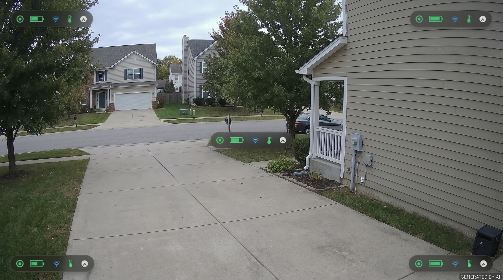

# eufy-frigate-battery-bridge

## Disclaimer

This is a fork of the
original [ljlongwing/eufy-frigate-battery-bridge](https://github.com/ljlongwing/eufy-frigate-battery-bridge) repository
with stability, visual, smart battery conservation, hardware-accelerated encoding, and telemetry enhancements.

All credit for the original concept and architecture goes to the original author under the [MIT License](LICENSE):

```
Copyright (c) 2026 ljlongwing

Permission is hereby granted, free of charge, to any person obtaining a copy
of this software and associated documentation files (the "Software"), to deal
in the Software without restriction, including without limitation the rights
to use, copy, modify, merge, publish, distribute, sublicense, and/or sell
copies of the Software, and to permit persons to whom the Software is
furnished to do so, subject to the following conditions:

The above copyright notice and this permission notice shall be included in all
copies or substantial portions of the Software.

THE SOFTWARE IS PROVIDED "AS IS", WITHOUT WARRANTY OF ANY KIND, EXPRESS OR
IMPLIED, INCLUDING BUT NOT LIMITED TO THE WARRANTIES OF MERCHANTABILITY,
FITNESS FOR A PARTICULAR PURPOSE AND NONINFRINGEMENT. IN NO EVENT SHALL THE
AUTHORS OR COPYRIGHT HOLDERS BE LIABLE FOR ANY CLAIM, DAMAGES OR OTHER
LIABILITY, WHETHER IN AN ACTION OF CONTRACT, TORT OR OTHERWISE, ARISING FROM,
OUT OF OR IN CONNECTION WITH THE SOFTWARE OR THE USE OR OTHER DEALINGS IN THE
SOFTWARE.
```

## Description

Get **Eufy battery cameras** into **Frigate**: event-driven recordings, `Frigate` detections, and on-demand live view
without draining batteries.

Eufy battery cameras sleep almost all the time and only stream when woken. Because `Frigate` requires a continuous
`RTSP` feed, this bridge publishes a persistent per-camera `ffmpeg` stream into Frigate's `go2rtc`:

- **While asleep:** Displays the camera's last live frame with a customizable status and telemetry overlay (no pixel
  motion, so `Frigate` records nothing).
- **On motion or doorbell ring:** Wakes the camera via [`eufy-security-ws`](https://github.com/bropat/eufy-security-ws)
  (using `HomeBase` `RTSP` when available or `P2P` livestreaming), feeds live video into the same unbroken `RTSP`
  stream, files a `Frigate` event (`person`, `car`, `dog`, or `motion`), and optionally notifies `Home Assistant`.
- **On overlapping events:** Streams `RTSP`-capable cameras (`T8161`) and standalone Wi-Fi cameras/doorbells
  concurrently, uses priority arbitration (`priority` + event boosts) per `HomeBase` station, and backfills any missed
  `P2P` recordings from `HomeBase` storage (`backfill_downloads`).
- **On live view:** Wakes the camera when a single-camera stream is opened in `Frigate`, while ignoring multi-camera
  dashboard grid views.

```
Eufy event ──► eufy-security-ws ──► bridge ──(wake, P2P / RTSP / Backfill)──► ffmpeg ──RTSP──► Frigate's go2rtc ──► Frigate
                                       └──► Frigate API (event)                 └──► HA webhook (optional)
```

## Enhancements in This Fork

- [Customizable Status Themes & Corner Placement](#customizable-status-themes--corner-placement)
- [Camera & Event Priority Arbitration](#camera--event-priority-arbitration)
- [Concurrent HomeBase RTSP, Multi-Station P2P & Clip Backfill](#concurrent-homebase-rtsp-multi-station-p2p--clip-backfill)
- [Low-Latency Stream & Drain-Aware Pipeline](#low-latency-stream--drain-aware-pipeline)
- [Live Camera Telemetry & Battery Swap Detection](#live-camera-telemetry--battery-swap-detection)
- [Persistent Snapshot Cache & Startup Probe](#persistent-snapshot-cache--startup-probe)
- [Hardware-Accelerated Encoding](#hardware-accelerated-encoding)
- [Doorbell & HomeBase 3 Intelligence](#doorbell--homebase-3-intelligence)
- [Smart Battery Conservation & Eufy-Controlled Event End](#smart-battery-conservation--eufy-controlled-event-end)
- [Cross-Camera Isolation & HomeBase Reboot Resilience](#cross-camera-isolation--homebase-reboot-resilience)
- [Structured Logging for Grafana Alloy & Loki](#structured-logging-for-grafana-alloy--loki)
- [Minimal Multi-Stage Container Image](#minimal-multi-stage-container-image)
- [Home Assistant Notifications](#home-assistant-notifications)

## Requirements

- `Frigate` `0.14+` (uses its built-in `go2rtc` and the `/api/events/.../create` API)
- `eufy-security-ws`, already logged in to your Eufy account and seeing the cameras
- `Docker` or `Podman`, on the same container network as `Frigate`

## Setup

**1. Config.** Copy `examples/config.example.minimal.json` (or `examples/config.example.full.json`) to `config.json` and
fill it in. Settings are grouped by function below:

### Core & Connection Settings

| Key            | Required | Default  | Meaning                                                                                                                                                                                                                                                                                                                                                                                                                                              |
|----------------|----------|----------|------------------------------------------------------------------------------------------------------------------------------------------------------------------------------------------------------------------------------------------------------------------------------------------------------------------------------------------------------------------------------------------------------------------------------------------------------|
| `eufy_ws`      | yes      | —        | `eufy-security-ws` `WebSocket` URL (e.g., `ws://eufy-security-ws:3000`)                                                                                                                                                                                                                                                                                                                                                                              |
| `go2rtc_api`   | yes      | —        | Frigate's `go2rtc` HTTP API URL, normally `http://frigate:1984`                                                                                                                                                                                                                                                                                                                                                                                      |
| `rtsp_publish` | yes      | —        | Where to publish each camera. `{name}` is replaced by the camera name. If Frigate's `go2rtc` has `rtsp.username/password` set, put them in the URL.                                                                                                                                                                                                                                                                                                  |
| `cameras`      | yes      | —        | Array of camera objects: `[{ "name", "serial", "title", "priority", "use_rtsp", "rtsp_url", "station_serial", "telemetry", "card_theme", "card_position", "card_background", "card_dim_background", "card_show_on_live", "auto_frigate_mask", "preserve_aspect_ratio", "startup_snapshot" }]`. `name` must match the `Frigate` camera name; `title` is shown on the status card; `priority` sets the camera's base arbitration weight (default `0`). |
| `frigate_api`  | no       | —        | Frigate's internal HTTP API (`http://frigate:5000`). Without it, no `Frigate` events are filed and early-sleep object checks are skipped.                                                                                                                                                                                                                                                                                                            |
| `ha_webhook`   | no       | —        | `Home Assistant` webhook URL (see [Home Assistant Notifications](#home-assistant-notifications))                                                                                                                                                                                                                                                                                                                                                     |
| `log_level`    | no       | `"info"` | Minimum log severity (`"debug"`, `"info"`, `"warn"`, `"error"`). Can also be set via the `LOG_LEVEL` environment variable.                                                                                                                                                                                                                                                                                                                           |

### Stream Timing, RTSP & Arbitration

| Key                           | Default | Meaning                                                                                                                                                                                                                                                                              |
|-------------------------------|---------|--------------------------------------------------------------------------------------------------------------------------------------------------------------------------------------------------------------------------------------------------------------------------------------|
| `priority` (per camera)       | `0`     | Base priority weight in `cameras[]` (`-10000` to `10000`). Combined with built-in event boosts (`rings`: `+1000`, `identity person`: `+300`, `person`: `+200`, `vehicle`/`pet`: `+100`, `sound`: `+50`, `motion`: `+10`) to decide stream takeovers with zero dwell delay.           |
| `use_rtsp`                    | `true`  | Automatically use `HomeBase` native `RTSP` (`rtspStreamUrl`) on cameras that support `NAS / RTSP Stream` so they stream concurrently without using the `HomeBase` `P2P` slot. Queues a `60 s` `P2P` fallback if `RTSP` does not connect within `14 s`. Can be overridden per camera. |
| `rtsp_url` (per camera)       | `""`    | Optional explicit `rtsp://` URL override for a camera in `cameras[]` (auto-discovered from `device.get_properties` when omitted)                                                                                                                                                     |
| `station_serial` (per camera) | `""`    | Optional explicit station serial override in `cameras[]` (auto-discovered from `stationSerialNumber` in `device.get_properties`)                                                                                                                                                     |
| `backfill_downloads`          | `true`  | Automatically query `HomeBase` local storage (`station.database_query_latest_info` / `station.database_query_by_date`) and replay missed event clips (`device.start_download`) at `15 fps` into `Frigate` once the station's `P2P` slot is free                                      |
| `backfill_delay_secs`         | `5`     | Seconds a station's `P2P` slot must remain idle before starting a queued post-event clip download                                                                                                                                                                                    |
| `hold_secs`                   | `60`    | Maximum time (seconds) to stay live after the last Eufy motion report                                                                                                                                                                                                                |
| `max_secs`                    | `900`   | Hard cap (seconds) for one continuous live period                                                                                                                                                                                                                                    |
| `view_linger_secs`            | `20`    | Stay live this long (seconds) after the last viewer leaves                                                                                                                                                                                                                           |
| `view_max_secs`               | `300`   | Hard cap (seconds) for a live period only viewers asked for                                                                                                                                                                                                                          |
| `viewer_cooldown_secs`        | `5`     | Ignore single-camera viewers that connect this soon (seconds) after a camera finishes streaming                                                                                                                                                                                      |
| `let_eufy_decide_event_end`   | `true`  | End event livestreams cleanly when Eufy reports `livestream stopped` or `5 s` after Eufy reports activity cleared (`state: false`, once at least `10 s` of video has been shown)                                                                                                     |
| `preempt_event_streams`       | `true`  | Allow a newer motion event on an equal-priority camera to take over immediately                                                                                                                                                                                                      |

### Events, Doorbell & HomeBase 3 Intelligence

| Key                      | Default                                                                                      | Meaning                                                                                                                                                                                                           |
|--------------------------|----------------------------------------------------------------------------------------------|-------------------------------------------------------------------------------------------------------------------------------------------------------------------------------------------------------------------|
| `trigger_events`         | `motion`, `person`, `pet`, `vehicle`, `dog`, `stranger`, `identity person`, `sound`, `rings` | Eufy event names (or shorthand aliases) that wake the camera and trigger a `Frigate` event                                                                                                                        |
| `event_secs`             | `30`                                                                                         | Duration of the `Frigate` event in seconds                                                                                                                                                                        |
| `snapshot_delay_secs`    | `3`                                                                                          | Seconds of continuous decoded video required before the event is filed (`1.2 s` on `RTSP`), so its snapshot isn't the `"Waking Up..."` card                                                                       |
| `instant_event_snapshot` | `true`                                                                                       | Immediately files `Frigate` events if a short clip finishes early and injects the clean un-overlayed `lastFrame` if a wake times out so `Frigate` never captures the `"Waking Up..."` card as the event thumbnail |
| `forward_face_names`     | `true`                                                                                       | Forwards `HomeBase 3` recognized face names (`identity person detected`) as Frigate's `sub_label` and `Home Assistant` webhook `person`                                                                           |
| `ring_label`             | `"person"`                                                                                   | `Frigate` event label filed when a doorbell `rings` event occurs                                                                                                                                                  |

### Smart Battery Conservation

| Key                         | Default | Meaning                                                                                                                                                                                        |
|-----------------------------|---------|------------------------------------------------------------------------------------------------------------------------------------------------------------------------------------------------|
| `early_sleep_secs`          | `0`     | Optional battery saver that puts a motion-woken camera to sleep early if motion has cleared and `Frigate` sees no active objects after this many seconds (`0` to disable; disabled by default) |
| `low_battery_threshold`     | `20`    | Battery `%` at or below which uncharged cameras enter Low-Battery Economy Mode (`0` to disable)                                                                                                |
| `low_battery_hold_secs`     | `20`    | Reduced motion hold duration in seconds while in Low-Battery Economy Mode                                                                                                                      |
| `low_battery_wake_on_view`  | `false` | Allow live-view requests to wake a camera in Low-Battery Economy Mode                                                                                                                          |
| `enforce_streaming_quality` | `true`  | `true` switches cameras set to `"Auto"` (`0`) to `Medium` (`7`, `1280×720`) so `P2P` streams do not negotiate `4K` and stall, or pass an explicit integer quality ID                           |

### Status Card Themes, Placement, Snapshot Cache & Telemetry

| Key                   | Default                        | Meaning                                                                                                                                                                                                                                                                                                         |
|-----------------------|--------------------------------|-----------------------------------------------------------------------------------------------------------------------------------------------------------------------------------------------------------------------------------------------------------------------------------------------------------------|
| `card_theme`          | `"default"`                    | `"default"` (text + icons), `"icons"` (vector icons only), `"minimal"` (three graduated status dots), or `"none"`/`"blank"` (no overlay; displays `card_background`). Can be overridden per camera.                                                                                                             |
| `card_position`       | `"center"`                     | Overlay placement for any theme: `"center"`, `"bottom-left"`, `"bottom-right"`, `"top-left"`, or `"top-right"`. Can be overridden per camera.                                                                                                                                                                   |
| `card_background`     | `"snapshot"`                   | Background behind the status card: `"snapshot"` (last live frame), `"slate"` (solid dark gray), or `"black"` (pitch-black). Can be overridden per camera.                                                                                                                                                       |
| `card_dim_background` | `false`                        | Dim the `"snapshot"` backdrop behind the status card (`true` / `false`). Disabled by default so unmasked background pixels outside the card do not trigger `Frigate` motion detection on sleep/wake transitions. Can be overridden per camera.                                                                  |
| `card_show_on_live`   | `true`                         | Keep corner status cards (`card_position !== "center"`) visible on the live video stream with a red on-air tally indicator (`Red` dot/play icon) and real-time telemetry while keeping saved snapshots clean. Can be overridden per camera.                                                                         |
| `auto_frigate_mask`   | `true`                         | Automatically calculate the normalized polygon for each camera's corner status card and apply both `motion.mask` and `objects.mask` (`eufy_bridge_card`) to `Frigate` via `PUT /api/config/set` (`requires_restart: 0`) on startup and automatically whenever `Frigate` restarts. Can be overridden per camera. |
| `telemetry`           | `true`                         | `true`, `false`, or an object controlling which telemetry items are shown on the sleeping card (see [Live Camera Telemetry & Battery Swap Detection](#live-camera-telemetry--battery-swap-detection)). Can be overridden per camera.                                                                            |
| `telemetry_poll_secs` | `300`                          | Background telemetry poll interval in seconds to detect battery swaps and charging updates while sleeping (`0` to disable)                                                                                                                                                                                      |
| `cache_dir`           | `"/config/cache"`              | Directory for persisting last live snapshots (`last_<name>_<serial>.jpg`) across container restarts (falls back to `"/tmp"`)                                                                                                                                                                                    |
| `startup_snapshot`    | `true`                         | `true` probes cameras once on startup if no cached frame exists, `"always"` forces a fresh probe on startup, `false` disables. Can be overridden per camera.                                                                                                                                                    |
| `font_file`           | `"/usr/share/fonts/Inter.ttf"` | Custom `.ttf` font path for `"default"` theme overlay text                                                                                                                                                                                                                                                      |

### Video, Audio & Hardware Acceleration

| Key                     | Default                 | Meaning                                                                                                                                 |
|-------------------------|-------------------------|-----------------------------------------------------------------------------------------------------------------------------------------|
| `audio`                 | `true`                  | Passes the camera's audio through (`16 kHz` mono `AAC`)                                                                                 |
| `preserve_aspect_ratio` | `true`                  | Preserves native aspect ratio with dark padding instead of stretching non-`16:9` streams. Can be overridden per camera.                 |
| `hwaccel`               | `false`                 | `false`, `"vaapi"`, `"qsv"`, `"nvenc"`, or `"v4l2m2m"` to offload continuous `H.264` encoding to GPU (falls back to `libx264` on error) |
| `hwaccel_device`        | `"/dev/dri/renderD128"` | Render device path for `vaapi`/`qsv`                                                                                                    |
| `width`                 | `1280`                  | Output stream width in pixels                                                                                                           |
| `height`                | `720`                   | Output stream height in pixels                                                                                                          |
| `live_fps`              | `15`                    | Output frame rate while the camera is live                                                                                              |
| `idle_fps`              | `5`                     | Output frame rate while the camera is asleep                                                                                            |

**2. Frigate.** Each battery camera reads the stream the bridge publishes into Frigate's `go2rtc`. Declare the stream in
`go2rtc` **with no source**: `go2rtc` refuses to accept a published stream it doesn't know (the bridge's encoder then
exits and restarts every 3 s with `"Failed reading RTSP data: End of file"`).

```yaml
go2rtc:
  streams:
    shed: # empty on purpose: the bridge publishes into it
cameras:
  shed:
    ffmpeg:
      inputs:
        - path: rtsp://127.0.0.1:8554/shed
          input_args: preset-rtsp-restream
          roles: [record, detect]
      output_args:
        record: preset-record-generic-audio-copy # or preset-record-generic without audio
    detect:
      width: 1280
      height: 720
      fps: 5
    record:
      continuous:
        days: 0 # keep only motion/alerts/detections, not hours of "camera asleep"
    live:
      streams:
        Main: shed
```

**3. Run it:** `docker compose -f examples/docker-compose.example.yml --project-directory . up -d --build`.

To build and publish to a local or remote container registry using the included `Makefile` (defaults to `Podman`):

```bash
# Syntax-check src/bridge.js and build image locally
make docker-build

# Build, tag, and push to a registry (default: publish locally with `latest` version when REGISTRY is omitted)
make publish [REGISTRY=<registry>] [BUILD_VERSION=<version>]

# Remove local build and publish tags
make clean
```

**4. Eufy camera settings.** By default (`"enforce_streaming_quality": true`), if a camera's streaming quality is set to
`"Auto"` (`0`), the bridge automatically sets `videoStreamingQuality` to **Medium (`1280×720`, value `7`)** via
`eufy-security-ws` so `P2P` sessions do not pick `4K` and stall. To force `Medium` even when a camera was manually set
to `High`/`4K`, set `"enforce_streaming_quality": 7`.

## Detailed Feature Guide

### Customizable Status Themes & Corner Placement

While a camera sleeps, the stream displays a frosted-glass status overlay over its last live frame (`"snapshot"`), a
solid dark gray canvas (`"slate"`), or pitch black (`"black"`). By default (`"card_dim_background": false`), pixels
outside the card are left un-dimmed so placing the card in a corner and covering that corner with a `Frigate` motion
mask prevents `Live ↔ Asleep` transitions from triggering false motion recordings.

| `card_theme` | Size (`1280×720`)                         | Description                                                                                                                                                                                             |
|--------------|-------------------------------------------|---------------------------------------------------------------------------------------------------------------------------------------------------------------------------------------------------------|
| `"default"`  | `820×336` (`center`) or `540×88` (corner) | Frosted-glass panel with full text + vector icons (`Asleep`, `Waking Up...`, `Waiting`) using Frigate's `Inter` typeface                                                                                |
| `"icons"`    | `Up to 216×44`                            | Zero-text, zero-`ffmpeg` frosted-glass capsule with vector icons: Status glyph, Battery + charging bolt, Curved Wi-Fi arcs colored by `RSSI`, Thermometer, and `Last live` analog clock (`HH:MM` hands) |
| `"minimal"`  | `92×36`                                   | Ultra-minimalist frosted-glass capsule with three graduated color-coded dots: `[Camera Status]  [Battery]  [Wi-Fi]`                                                                                     |
| `"none"`     | Full frame                                | Hides the status overlay while honoring `card_background` (`"snapshot"`, `"slate"`, or `"black"`)                                                                                                       |

#### Visual Previews

Here is how the **Icons Theme** (`card_theme: "icons"`) looks:



Note: All samples are AI-generated.

#### 6-Color Semantic Scale (`Red`, `Grey`, `Green`, `Blue`, `Yellow`, `Purple`)

| Color                  | Dot 1 / Status Glyph (`▶` / `●` / `⏸`)         | Dot 2 / Battery Icon                   | Dot 3 / Wi-Fi & `RSSI` Arcs                       | Thermometer Icon (`icons` theme) |
|------------------------|------------------------------------------------|----------------------------------------|---------------------------------------------------|----------------------------------|
| **Red** (`#ef4444`)    | **Live** (`▶` On-air stream running)           | *Unused (reserved for Live)*           | *Unused (reserved for Live)*                      | *Unused (reserved for Live)*     |
| **Grey** (`#b4b4be`)   | **Asleep** (`⏸` Standby & ready)               | *Unused*                               | *Unused*                                          | *Unused*                         |
| **Green** (`#4ade80`)  | *Unused*                                       | **Good** (`>= 50%`)                    | **Strong** (`4/4` bars or `>= -65 dBm`)           | **Normal** (`6°C – 35°C`)        |
| **Blue** (`#38bdf8`)   | **Waking Up** (`●` Connecting)                 | **Charging / Solar / Plugged**         | **Good / Average** (`3/4` bars or `-66..-72 dBm`) | **Cold** (`<= 5°C`)              |
| **Yellow** (`#facc15`) | **Waiting** (`⏸` `HomeBase` busy)              | **Medium** (`21% – 49%`)               | **Fair / Weak** (`2/4` bars or `-73..-80 dBm`)    | **Warm** (`36°C – 44°C`)         |
| **Purple** (`#e879f9`) | **Low-Battery Economy Mode** (`⏸`)             | **Low / Critical** (`<= 20%` or `n/a`) | **Poor** (`0–1/4` bars, `< -80 dBm`, or `n/a`)    | **Hot** (`>= 45°C`)              |

#### Frigate `motion.mask` Coordinates for Corner Placement (`1280×720`)

| `card_position`  | `"default"` (`540×88`)                            | `"icons"` (`216×44`)                              | `"minimal"` (`92×36`)                             |
|------------------|---------------------------------------------------|---------------------------------------------------|---------------------------------------------------|
| `"top-left"`     | `0.015,0.028,0.015,0.160,0.445,0.160,0.445,0.028` | `0.015,0.028,0.015,0.100,0.190,0.100,0.190,0.028` | `0.015,0.028,0.015,0.090,0.095,0.090,0.095,0.028` |
| `"top-right"`    | `0.555,0.028,0.555,0.160,0.985,0.160,0.985,0.028` | `0.810,0.028,0.810,0.100,0.985,0.100,0.985,0.028` | `0.905,0.028,0.905,0.090,0.985,0.090,0.985,0.028` |
| `"bottom-left"`  | `0.015,0.840,0.015,0.972,0.445,0.972,0.445,0.840` | `0.015,0.900,0.015,0.972,0.190,0.972,0.190,0.900` | `0.015,0.910,0.015,0.972,0.095,0.972,0.095,0.910` |
| `"bottom-right"` | `0.555,0.840,0.555,0.972,0.985,0.972,0.985,0.840` | `0.810,0.900,0.810,0.972,0.985,0.972,0.985,0.900` | `0.905,0.910,0.905,0.972,0.985,0.972,0.985,0.910` |

### Camera & Event Priority Arbitration

For cameras sharing a `HomeBase` `P2P` slot, the bridge arbitrates access using an effective priority score
(`camera.priority + eventBoost`):

- **Built-in event boosts:** `rings` (`+1000`) > `identity person` (`+300`) > `person` / `stranger` (`+200`) >
  `vehicle` / `pet` / `dog` (`+100`) > `crying` / `sound` (`+50`) > `motion` (`+10`).
- **Instant zero-dwell switching:** Higher-priority events (such as a doorbell ring while a lower-priority camera is
  streaming) and newer events across equal-priority cameras switch immediately with zero dwell delay.
- **Priority protection:** Lower-priority cameras never interrupt an active higher-priority event until its motion
  clears, and viewer clicks never block or preempt event-triggered streams.

### Concurrent HomeBase RTSP, Multi-Station P2P & Clip Backfill

To overcome the single-stream `HomeBase` `P2P` limitation when multiple cameras trigger at the same time, the bridge
combines three mechanisms:

- **HomeBase Native `RTSP` Ingestion (`use_rtsp: true`):** When `NAS (RTSP Stream)` is enabled for a camera in the Eufy
  app (such as `eufyCam 3C` / `T8161`), the bridge automatically discovers its `rtspStreamUrl`, wakes the camera's
  `RTSP` feed via `rtspStream=true` and `device.start_rtsp_livestream`, and streams multiple `RTSP` cameras in parallel
  (`WAKE [RTSP]`) without using the `HomeBase` `P2P` slot—leaving `P2P` completely free for `P2P`-only devices like
  video doorbells (`T8214`). If the `HomeBase` `RTSP` server does not deliver frames within `14 s`, the bridge queues a
  `60 s` `P2P` fallback through `arbitrate()`.
- **Per-Station (`stationSerial`) Concurrent `P2P` Arbitration:** `P2P` arbitration and transition locks are scoped per
  `stationSerialNumber` rather than globally. Standalone Wi-Fi cameras/doorbells (or cameras paired to a second
  `HomeBase`) stream over `P2P` 100% concurrently alongside your primary `HomeBase`.
- **Post-Event Clip Download Backfill (`backfill_downloads: true`):** If two `P2P`-only cameras on the same `HomeBase`
  trigger simultaneously, the `HomeBase` still records the secondary camera's clip to its internal storage. Once that
  station's `P2P` slot has been idle for `backfill_delay_secs` (`5 s`), the bridge queries
  `station.database_query_latest_info` and `station.database_query_by_date`, locates the missed `.zxvideo` recording
  (`storage_path` + `cipher_id`), streams it into `Frigate` at `15 fps` real-time speed via `device.start_download`
  (`WAKE [BACKFILL DOWNLOAD]`), and files the corresponding `Frigate` event. Any new live motion or viewer request
  immediately cancels and preempts an active backfill download.

### Low-Latency Stream & Drain-Aware Pipeline

- **Low-latency decoding:** Spawns per-session `P2P` `ffmpeg` decoders with
  `-fflags +genpts+nobuffer -flags low_delay -probesize 32768 -analyzeduration 0` and `RTSP` pull decoders with
  `-fflags +genpts+nobuffer -flags low_delay -rtsp_transport tcp` so the first keyframe is decoded immediately.
- **Drain-aware pipe backpressure (`15 fps` live / `5 fps` idle):** Listens to `enc.stdin.on('drain')` to flush newly
  decoded `1.38 MB` `YUV420p` frames the millisecond `ffmpeg` drains the pipe, eliminating dropped frames and playback
  jerkiness.
- **Fast handovers & keyframe bursts:** Uses a `150 ms` `P2P` settle transition, `750 ms` viewer polling, and `1.2 s`
  keyframe bursts on viewer connect or state change.

### Live Camera Telemetry & Battery Swap Detection

Queries `device.get_properties` (compatible with `eufy-security-ws` API schema `13`–`21`), polls periodically
(`telemetry_poll_secs`), and issues `driver.poll_refresh` to detect physical battery swaps and charging state
transitions while asleep.

Telemetry on the sleeping overlay is **enabled by default** and can be customized globally or per camera:

```json
{
	"telemetry": {
		"enabled": true,
		"battery": true,
		"power_source": true,
		"wifi": true,
		"rssi": true,
		"temperature": true,
		"last_seen": true
	},
	"cameras": [
		{
			"name": "front_doorbell",
			"serial": "T8214...",
			"title": "Front Doorbell",
			"priority": 100,
			"card_theme": "icons",
			"card_position": "bottom-left",
			"preserve_aspect_ratio": true,
			"telemetry": {
				"temperature": false
			}
		}
	]
}
```

| Telemetry Key  | Default | Description                                                                                  |
|----------------|---------|----------------------------------------------------------------------------------------------|
| `enabled`      | `true`  | Master switch for telemetry items (`default` and `icons` themes)                             |
| `battery`      | `true`  | Color-coded battery icon and charge percentage (`0–100%`)                                    |
| `power_source` | `true`  | Appends `Charging`, `Solar`, `Plugged`, or `Eco` status (or lightning bolt in `icons` theme) |
| `wifi`         | `true`  | Curved Wi-Fi signal strength indicator (`0–4`)                                               |
| `rssi`         | `true`  | Displays Wi-Fi `RSSI` in `dBm` (and colors Wi-Fi arcs by `RSSI` quality)                     |
| `temperature`  | `true`  | Displays battery temperature in `°C` (or thermometer icon in `icons` theme)                  |
| `last_seen`    | `true`  | Displays `Last live HH:MM` (or analog clock with `HH:MM` hands in `icons` theme)             |

### Persistent Snapshot Cache & Startup Probe

Stores high-quality `last_<name>_<serial>.jpg` snapshots in `/config/cache` (`cache_dir`) so background snapshots
survive container restarts. Updates `lastFrame` on the very first decoded keyframe of every session so preempted streams
never revert to stale pre-stream frames. If a camera has no cached snapshot on startup, the bridge can briefly wake it
once (`startup_snapshot`), capture 2 seconds of stable video, and put it back to sleep.

### Hardware-Accelerated Encoding

Supports `vaapi` (Intel/AMD iGPUs, including AMD RDNA 3.5 `gfx1150`/`gfx1151` via `alpine:3.23` Mesa `25.2+`), `qsv`,
`nvenc`, and `v4l2m2m` to offload continuous `H.264` encoding to the GPU, with automatic fallback to software `libx264`
if hardware initialization fails.

### Doorbell & HomeBase 3 Intelligence

- **Doorbell ring wakeup (`rings`):** Wakes video doorbells (`T8214`) immediately on button press with a `+1000`
  priority boost and files a `Frigate` event (`ring_label`, default `person`).
- **HomeBase 3 face name forwarding (`forward_face_names`):** Extracts recognized face names from
  `identity person detected` events and passes them as Frigate's `sub_label` and in the `Home Assistant` webhook payload
  (`person`).
- **Aspect-ratio safe Lanczos scaling (`preserve_aspect_ratio`):** Uses `flags=lanczos` and
  `force_original_aspect_ratio=decrease` with centered dark padding so `4:3` or portrait dual-lens doorbell streams
  (`T8214`) are sharp and never stretched.

### Smart Battery Conservation & Eufy-Controlled Event End

- **Eufy-controlled event end (`let_eufy_decide_event_end`):** Puts event-woken cameras to sleep `5 s` after Eufy
  reports activity cleared (`state: false`, once at least `10 s` of video has been shown) or immediately when Eufy sends
  `livestream stopped`, while capping continuous activity at `hold_secs` (`60 s`) after the last trigger.
- **Low-Battery Economy Mode (`low_battery_threshold`):** When battery drops to or below `20%` (and is not charging),
  automatically shortens motion hold duration (`low_battery_hold_secs`) and blocks viewer-triggered wakeups
  (`low_battery_wake_on_view: false`).
- **Optional early sleep (`early_sleep_secs`):** Can put a motion-woken camera to sleep early if Eufy motion has cleared
  and `Frigate` reports no active tracked detections (`0` / disabled by default).
- **Auto-enforce streaming quality (`enforce_streaming_quality`):** Automatically switches cameras set to `"Auto"` (`0`)
  to `Medium` (`7`, `1280×720`) so `P2P` streams do not negotiate `4K` and stall.

### Cross-Camera Isolation & HomeBase Reboot Resilience

Serializes `P2P` stop/start handovers per station, ignores `eufy-security-client` station-cached notification thumbnails
(`properties.picture`), recovers cleanly from `HomeBase` station reboots (`station` disconnect/connect events) without
interrupting `RTSP` feeds, ignores simultaneous multi-camera dashboard grid views, and handles mid-stream Eufy
resolution changes in-band without restarting the decoder.

### Structured Logging for Grafana Alloy & Loki

Formats every log line identically as `YYYY-MM-DD HH:MM:SS [LEVEL] [camera] message` (`[DEBUG]`, `[INFO]`, `[WARN]`,
`[ERROR]`, configurable via `LOG_LEVEL` or `log_level`) using ICU-free local ISO timestamps and structured
`initiator=...` / `reason="..."` attributes for `Grafana Alloy` and `Loki` ingestion.

### Minimal Multi-Stage Container Image

Built on `Alpine Linux 3.23` with `tini` as `PID 1`, running as a non-root `node` user (`UID 1000`).

### Home Assistant Notifications

With `ha_webhook` set, the bridge `POST`s `JSON` twice per Eufy event:

1. **Right away:** `{"camera", "title", "label"}` (plus `"person"` when `HomeBase 3` recognizes a face). Good for a fast
   text alert.
2. **Once the Frigate event exists:** the same keys plus `event_id`, `review_id`, and `no_video` (`true` if the camera
   never sent video, so the snapshot is a placeholder). Good for a follow-up with the snapshot
   (`/api/frigate/notifications/<event_id>/snapshot.jpg` via the `Frigate` integration) and a link to Frigate's `Review`
   page.

Trigger an automation with `platform: webhook` and use `trigger.json.event_id` to tell the two apart.

## Troubleshooting

- **Encoder exits every 3 s with `"Failed reading RTSP data: End of file"`:** the stream isn't declared in
  `go2rtc.streams` (step 2), or the `RTSP` user/password in `rtsp_publish` is wrong.
- **Nothing wakes on motion:** notifications must be on for the camera in the Eufy app, otherwise `eufy-security-ws`
  gets no motion events. Mute them on the phone instead of turning them off.
- **Stuck on `"Waking Up..."`, then `"stream stalled ... resetting decoder"`:** check the camera's streaming quality
  (step 4), its battery and Wi-Fi signal, and that the Eufy app can open it live.
- **`"start_livestream failed"`:** `eufy-security-ws` lost its Eufy session or the `HomeBase` is busy with another `P2P`
  stream (the Eufy app counts too).
- **Inspecting Eufy device models, serials, and firmware versions:**
  ```bash
  podman exec eufy-frigate-battery-bridge node -e '
    const fs = require("fs");
    const WS = require("ws");
    const cfgPath = process.env.BRIDGE_CONFIG || process.env.CONFIG_PATH || "/config/config.json";
    const cfg = JSON.parse(fs.readFileSync(cfgPath, "utf8"));
    const ws = new WS(cfg.eufy_ws);

    let id = 0;
    const send = (cmd) => ws.send(JSON.stringify({ messageId: String(++id), ...cmd }));
    const unwrap = (v) => (v && typeof v === "object" && "value" in v ? v.value : v);

    ws.on("message", (raw) => {
      const m = JSON.parse(raw);
      if (m.type === "version") {
        send({ command: "set_api_schema", schemaVersion: Math.min(m.maxSchemaVersion, 21) });
        send({ command: "start_listening" });
      } else if (m.messageId === "2") {
        for (const s of m.result?.state?.stations || []) {
          send({ command: "station.get_properties", serialNumber: s.serialNumber || s });
        }
        for (const d of m.result?.state?.devices || []) {
          send({ command: "device.get_properties", serialNumber: d.serialNumber || d });
        }
        setTimeout(() => process.exit(0), 1500);
      } else if (m.type === "result" && m.result?.properties) {
        const p = m.result.properties;
        console.log(
          unwrap(p.name) +
            " | model=" + unwrap(p.model) +
            " | serial=" + unwrap(p.serialNumber) +
            " | fw=" + unwrap(p.softwareVersion) +
            " | hw=" + unwrap(p.hardwareVersion)
        );
      }
    });
  '
  ```

## Good to know

- **Battery.** Every wake costs battery, the same as opening the camera in the Eufy app. `let_eufy_decide_event_end` and
  Low-Battery Economy Mode (`low_battery_threshold`) help minimize unnecessary live streaming time.
- **Latency.** First video arrives about 1–3 s after the wake on `RTSP` or 2–4 s on `P2P`, so a quick walk-past may be
  half over. That's why the bridge files Eufy's own detection as a `Frigate` event.
- **Missed events are Eufy-side.** If Eufy's own detection doesn't fire, nothing wakes the camera.
- **Asleep ↔ live switches look like motion to Frigate,** and Frigate's Live dashboard auto-opens cameras with activity.
  The bridge ignores viewers that connect while a camera is already live or just went to sleep, ignores simultaneous
  multi-camera grid views, cancels earlier viewer queues when switching `P2P` cameras, keeps background pixels un-dimmed
  (`card_dim_background: false`), and supports corner placements, `icons`/`minimal` themes, or `none` mode so `Frigate`
  never triggers false detections on the sleeping overlay.
- **CPU.** Idle ~1–3% of one core. While a camera is live, ~15–25% with `hwaccel: "vaapi"` or ~35–65% with software
  `libx264`.
- **Test hooks:** `docker kill -s USR2 eufy-frigate-battery-bridge` files a synthetic `"test"` event on the first camera
  without waking it, and `docker kill -s USR1 eufy-frigate-battery-bridge` triggers an on-demand backfill download of
  the latest recorded HomeBase clip at `15 fps`.

## Tested with

- **This fork's setup:**
	- **Station:** Eufy **HomeBase 3 (S380)** (`T8030`, firmware `3.8.7.4`, hardware `V05`) with **Video Doorbell Dual
	  Chime** (`T8023`, firmware `3.3.2.2m_0.1`, hardware `P0`)
	- **Cameras:** Eufy **Video Doorbell E340 Dual** (`T8214`, firmware `3.2.7.2`, hardware `P2`) and two **eufyCam
	  S300 (eufyCam 3C)** cameras (`T8161`, firmware `3.4.3.0`, hardware `P1`)
	- **Environment:** `Podman` Quadlet, `AMD Radeon 8060S` (`gfx1151`, `VA-API` via `Mesa 25.2`), `Frigate 0.18`,
	  `go2rtc`, and `eufy-security-ws` (API schema `21`)
- **Original repository setup:** `Frigate` `0.18.2`, `eufy-security-ws` `3.1.0` (`eufy-security-client` `4.1.0`, API
  schema `21`), two Eufy `T8162` battery cameras (firmware `3.1.5.8`) on a **HomeBase 3**.
- **Reported working by users (#1):** **eufyCam 2C** `T8140-Z` (firmware `4.1.4`, motion + live view wake) and **eufyCam
  3** `T8160` (firmware `3.4.3.0`, motion + live view wake), both on a **HomeBase 3**.

Heads-up: `eufy-security-client` describes itself as a stopgap while Eufy moves to a new platform, so upstream changes
may break this.

## Notes

- Originally created by [ljlongwing](https://github.com/ljlongwing) with help from Claude (Anthropic).
- Fork enhancements were architected and developed by [obatiuk](https://github.com/obatiuk) in collaboration with Gemini
  Argon (Google), and tested on a live HomeBase 3 setup.

## License

[`MIT`](LICENSE)
