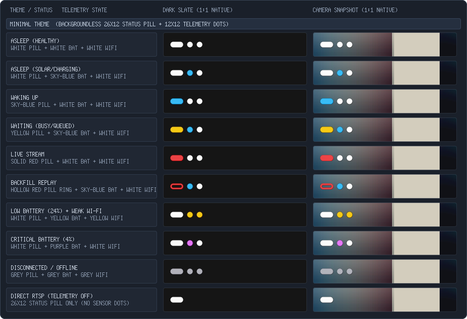
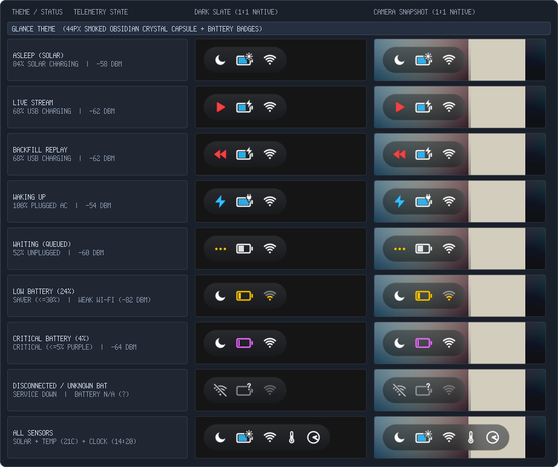
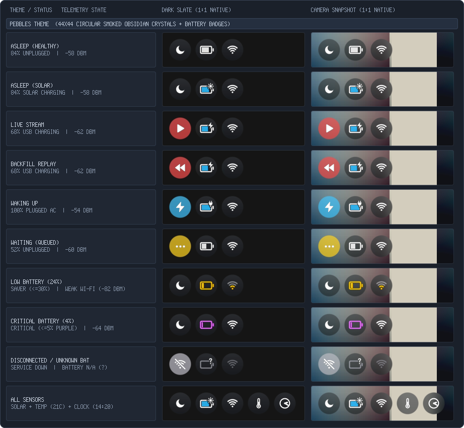
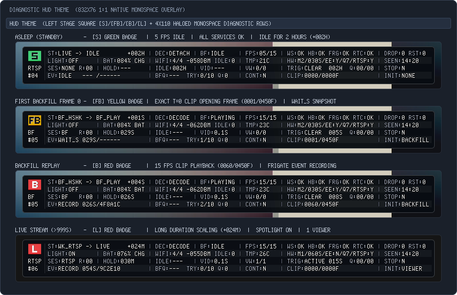

# Status card themes, mask sync, and diagnostic HUD

Read when: changing `src/domain/status-card.js`, `src/overlay/*`, Frigate mask sync, or the `hud` theme.
Related: [ACCEPTANCE.md](ACCEPTANCE.md) (`AT-17`, `AT-18`), [status-card-minimal.png](images/status-card-minimal.png),
[status-card-glance.png](images/status-card-glance.png), [status-card-pebbles.png](images/status-card-pebbles.png),
[status-card-hud.png](images/status-card-hud.png).

## Status Card Themes & Overlay Pipeline (`src/domain/status-card.js` & `src/overlay/*`)

- **Surface, Iconography & Calm-White Palette:**
  - Capsule status cards (`"glance"`, `"pebbles"`) share a borderless, hairline-free **Smoked Obsidian Crystal**
    surface (`drawCrystalSurface` in `src/overlay/yuv-canvas.js`: single-pass floating-point compositor with 16x
    (`4x4` subpixel) cubic Hermite `smoothstep` edge anti-aliasing, `0.5px` tangent inset, `2x2` YUV420p quad chroma
    averaging, 3-pass luma/chroma box blur with `0.82` chroma damping, `54%` Smoked Obsidian `#080b12` tint on
    non-jewel capsules, `11%` top-lit white frost sheen, and strictly `0px` outer hairline or white border rim).
  - Icons and HUD text render purely in JavaScript with zero `ffmpeg` subprocesses or external `.ttf` files via
    `src/overlay/ui-glyphs.js` and `src/overlay/yuv-canvas.js`: 16x-subpixel `smoothstep` analytical SDF vector sprites
    and linear deflate-compressed 4-bit nibble alpha atlases for solid-filled **Lucide** (`ISC`) status icons
    (`standby` crescent moon, `live` play triangle, `backfill` rewind double-triangles, and `waking` lightning bolt
    `zap`, plus a 16x-subpixel three-horizontal-dots `•••` ellipsis for `waiting`, with strictly zero glare circle
    behind status icons), 4-tier Wi-Fi arcs, `30x20` battery shells with pre-baked `15x15` top-right power badges
    (`solar`, `plugged`, `bolt`, and `unknown` `?` when battery percentage is unavailable) and `1.65px` crystal cutouts,
    and a 5x9 bitmap monospace font for the diagnostic `"hud"` theme.
  - By default (`resolveTelemetryConfig` in `src/config.js`), `battery`, `power_source`, `wifi`, and `rssi` default to
    `true`, `temperature` and `last_seen` default to `false` (hidden unless explicitly enabled in `telemetry`), and
    `telemetry` is completely disabled (`enabled: false`) whenever direct `rtsp_url` is configured on a camera.
  - Normal states stay **Calm White** (`#ffffff`): `Asleep` and `Asleep (Low Battery)` status silhouettes, healthy
    unplugged battery (`> 30%`), healthy Wi-Fi (`>= 2` bars / `>= -80 dBm`), and normal temperature (`6..35°C`).
    Chromatic accents appear only on active state changes or anomalies: **Sky Blue** (`#38bdf8`) for `Waking Up...`,
    subtle charging battery inner fill (`Solar` / `Plugged` / `Charging` inside a crisp shell with a `15x15` `sun`,
    `plug`, or `zap` badge overlaid on the top-right corner with a crystal cutout), and cold (`<= 5°C`); **Yellow**
    (`#facc15`) for `Waiting`, unplugged low battery (`6..30%`), `1-bar` weak Wi-Fi (`<= -81 dBm`), and warm
    (`36..44°C`); **Purple** (`#e879f9`) for unplugged critical battery (`<= 5%` in `"minimal"`, `"glance"`, and
    `"pebbles"`) and hot (`>= 45°C`); **Red** (`#ef4444`) for `Live` and `Backfill`; and **Grey** (`#b4b4be`) for
    `Disconnected` and unavailable sensors.
- `card_theme` (clean cutover; unknown values log a warning and default to `"minimal"`):
  - `"minimal"` (default): Backgroundless `64x12` footprint (`26x12` when battery and Wi-Fi telemetry are disabled, such
    as when `rtsp_url` is set; `0px` capsule padding, `7px` gaps, `{boxX: 24, boxY: 684, boxW: 64, boxH: 12}` in
    `bottom-left`) rendering a floating `26x12` stadium pill for **Status** (solid `pillFg` in normal/live states, or
    hollow `2.5px`-stroke `pillRing` during `Backfill`) followed by up to two `12x12` circles for **Battery** and
    **Wi-Fi** when enabled, with outer optical shadows and no background capsule (never icons or text).
  - `"glance"`: `44px`-tall Smoked Obsidian crystal capsule (`16px` horizontal padding, `14px` item gaps, `138x44`
    default bounds or `210x44` when all telemetry items are enabled) with solid-filled `24x24` status icons
    (crescent `moon` for `Asleep` and `Low Battery`, three horizontal dots `•••` for `Waiting`, `zap` lightning bolt for
    `Waking Up...`, `play` for `Live`, `rewind` for `Backfill`, `wifi-off` for `Disconnected`), `30x20` battery shell +
    merged top-right `15x15` power badge (`sun`, `plug`, `zap`, or `?` when battery level is unknown) with crystal
    cutout, `24x24` 4-tier Wi-Fi arcs, and optional `20x24` thermometer and `24x24` clock ring with cached `HH:MM`
    hands.
  - `"pebbles"`: Multi-pebble `44px`-tall layout (`148x44` default or `252x44` all-icons combined Frigate
    mask bounds) rendering separate `44x44` circular Smoked Obsidian crystal pebbles separated by `8px` untouched
    live-video gaps: a circular `44x44` **Status Pebble** (pure crystal with a crescent moon when `Asleep` or
    `Low Battery`, flooding with `72%` semantic `statusRgb` jewel tint + `6%` frost sheen and a crisp white contour icon
    whenever active/fault) followed by individual `44x44` circular pebbles for each enabled sensor icon (**Battery**
    `44x44` with `+2px` visually centered `30x20` shell and merged top-right `15x15` power or `?` unknown badge,
    **Wi-Fi** `44x44`, **Temperature** `44x44`, and **Clock** `44x44`), omitting any pebble whose icon is configured not
    to be shown.
  - `"hud"`: High-contrast diagnostic HUD (`832x76`, `<= 2/3` of the `1280px` frame width; positioned at any of the 7
    `card_position` placements using the same `getCardBoxCoords` rules as other themes)
    over a `6px` rounded deep-slate matte scrim (`86%`
    `#0a0d13`, normalized backdrop luma, `92%` chroma desaturation, `1px` `22%` white border, alternating `4.5%`
    row bands on rows 1 & 3, and `1px` `14%` vertical divider at `boxX + 45`) with a left semantic status square (`S`
    preserving **Green** when `Asleep`, `FB`, `B`, `L` + mode + `#sessionId`) and 4 non-shifting `110`-char monospace
    rows (`5x9` bitmap font with 5-sample dark halo and neutral-luma hierarchy: `45%` halo `|` pipes, `75%` halo `KEY:`
    labels, `88%` halo crisp white values) updated dynamically on both sleeping and live frames
    (`hasDynamicDebugCard()`).
  - `"none"`: Hides the status overlay while honoring `sleep_screen` (`"snapshot"`, `"slate"`, or `"black"`).
- `card_position`: `"bottom-left"` (default), `"bottom-center"`, `"bottom-right"`, `"top-left"`, `"top-center"`,
  `"top-right"`, or `"center"` (aliases `"center-top"` and `"center-bottom"` normalize to `"top-center"` and
  `"bottom-center"`).
- `sleep_screen`: `"snapshot"` (default, last camera frame from `/config/cache`), `"slate"` (solid `#222222`), or
  `"black"` (solid `#101010`).
- `card_show_on_live` (`true` by default): Composites corner status cards onto live/backfill video frames via the 2-slot
  alternating `liveOverlayBufs` scratch ring (`prepareLiveOverlayBuffer`) using `Red` status indicators (Lucide
  `play`/`rewind` contours in `"glance"` and `"pebbles"`, or a solid pill / hollow pill ring in `"minimal"`), while
  keeping `cam.lastFrame` and `/config/cache` snapshots clean (`"hud"` always renders on live frames unless
  `suppressLiveCard` is active).
- `auto_frigate_mask` (`true` by default): Computes the normalized polygon bounding box for each camera's corner status
  card (with a `6px` chroma/anti-aliasing safety margin) and syncs both `motion.mask.eufy_bridge_card` and
  `objects.mask.eufy_bridge_card` into Frigate via `GET /api/config` and `PUT /api/config/set` (`requires_restart: 0`)
  on startup, every 60s, and after Frigate restarts (deleting only bridge-created `eufy_bridge_card` masks when
  `card_theme: "none"` or `card_position: "center"`).

### Theme Previews

Click any preview below to inspect the `1:1` native rendering across dark slate and camera snapshot backgrounds:

|                    `"minimal"` (default)                     |                         `"glance"`                         |                         `"pebbles"`                          |                `"hud"` (diagnostics)                |
| :----------------------------------------------------------: | :--------------------------------------------------------: | :----------------------------------------------------------: | :-------------------------------------------------: |
|  |  |  |  |

## Troubleshooting & Visual Diagnostics (`card_theme: "hud"`)

Setting `"card_theme": "hud"` (globally or per camera) renders a diagnostic HUD (`832x76`, positioned according to
`card_position`) over both sleeping and live frames so you can visually inspect every state transition, frame stage,
hardware property, and backfill clip directly inside Frigate Live View or recorded clips.

### Left Status Column (Frame Stage Square, Camera Mode & Session Counter)

- **Top Colored Square (`[S]` / `[FB]` / `[B]` / `[L]`):**
  - `[S]` (**Snapshot / Sleeping / Waking Frame**): Shown whenever the encoder is outputting the cached sleeping
    snapshot (while idle, waiting, or waking before `gotVideo` is set on the session). The square background color
    reflects the current non-live status: **Green** (`Asleep` and `Asleep (Low Battery)`, standby & ready), **Grey**
    (`Disconnected` when `eufy-security-ws`, `HomeBase`/camera, `Frigate`, or `go2rtc` is down/unavailable), **Blue**
    (`Waking Up...`), or **Yellow** (`Waiting` for station slot or `BackfillJob`).
  - `[FB]` (**First Backfill Frame `0`**, **Yellow** background with dark block letters): Shown on the very first
    decoded frame (`Frame 0`, while `downloadPlayedFrames <= 1`) of a newly started `.zxvideo` backfill download so you
    can visually pinpoint the exact `t=0` start frame of the clip.
  - `[B]` (**Backfill Video Frames `1..N`**, **Red** background with white block letter): Shown on all subsequent
    frames (`downloadPlayedFrames > 1`) of a `.zxvideo` backfill playback (and held continuously across back-to-back
    continuation handshakes when `CONT:Y` is active so the badge never flashes back to `S` or `FB` between split clips).
  - `[L]` (**Live Stream Video Frames**, **Red** background with white block letter): Shown once live `RTSP` or `P2P`
    video is active (`gotVideo === true`).
- **Middle Tag (`BF` / `RTSP` / `DIR` / `P2P` / `AUTO` / `CUST`):** Configured camera operating mode (`mode`).
- **Bottom Tag (`#00`-`#99`):** Monotonic session counter (`sessionId` clamped at `99`) incremented on each session
  start (wake or backfill download).

### What Each Row Displays (for Instant Visual Verification & Future Debugging)

1. **Row 1 - FSM States, Transitions, Frame Pacing & Service Health:**
   - `ST:<prev>-><curr>+<age>`: Previous -> current session state (`IDLE`, `WK_RTSP`, `WK_P2P`, `LIVE`, `BF_HSHK`,
     `BF_PLAY`, `BF_TAIL`, `COOLDWN`) and elapsed duration in the current state (`000s`-`999s`, scaling automatically to
     minutes `m`, hours `h`, days `d`, weeks `w`, and years `y` past `999s` across all 4-char HUD timer fields).
   - `DEC:<state>`: Decoder FSM state (`DETACH`, `HSHK`, `DECODE`, `PAUSED`, `FLUSH`).
   - `BF:<state>`: Backfill FSM state (`IDLE`, `ACTIVE`, `WAIT_Q`, `QUERY`, `MATCH`, `PLAYING`, `DONE`, `EXPIRED`).
   - `FPS:<measured>/<target>`: Real-time measured output FPS over a rolling `1s` window vs target FPS (`05` idle / `15`
     live).
   - `WS:<OK|DN> HB:<OK|DN> FRG:<OK|DN> RTC:<OK|DN>`: Real-time connectivity indicators for `eufy-security-ws` (`WS`),
     `HomeBase`/camera (`HB`), `Frigate` (`FRG`), and `go2rtc` (`RTC`).
   - `DROP:<n> RST:<n>`: Dropped frame/packet count (`0-9+`) and mid-session restart count (`0-9`).
2. **Row 2 - Spotlight (`light`), Battery, Radio/Idle RSSI Drain Detector & Synced Hardware Settings:**
   - `LIGHT:ON` / `LIGHT:OFF`: Real-time camera spotlight (`light`) state.
   - `BAT:<pct>% <src>`: Battery percentage (`000%-100%`, or `---%` before telemetry) and power status (`CHG` when
     charging/solar/plugged, `LOW` in low-battery saver, or `BAT`).
   - `WIFI:<bars>/4 <rssi>dBm IDLE:<n>`: Wi-Fi bars, RSSI in dBm, and `IDLE:<n>` (`idleRssiChangeCount` counter so you
     can immediately see if a sleeping camera is spamming `wifiRssi` updates).
   - `TMP:<c>C`: Camera battery temperature.
   - `HW:M<mode>/<clipLen>s/EE:<Y|N>/Q<quality>/RTSP:<Y|N>`: Eufy hardware settings (`powerWorkingMode`,
     `recordingClipLength`, `recordingEndClipMotionStops`, `videoStreamingQuality`, and `RTSP` capability/URL status
     `useRtsp && (rtspUrl || rtspSupported)`, seeded from `hwRecordingCfg` until camera properties arrive).
   - `SEEN:<HH:MM>`: Local wall-clock `HH:MM` timestamp of the last decoded video frame or cached snapshot (`----` when
     none).
3. **Row 3 - Active Session, Hold/Cooldown Timers, Viewers, Eufy Trigger State & Frame Queues:**
   - `SES:<mode> R:<retries>`: Active stream mode (`NONE`, `RTSP`, `P2P`, `BF`) and retry count.
   - `HOLD:<rem>`: Remaining seconds on the active `motionUntil` / `viewUntil` hold timer.
   - `IDLE:<age>`: Elapsed seconds since the last motion trigger (`lastMotionAt`) while inactive (`---` while active).
   - `VID:<age>`: Time since the last decoded video frame arrived (`0.0s-9.9s`).
   - `VW:<waking>/<total>`: Active single-camera waking viewers vs total `go2rtc` viewers.
   - `TRIG:ACTIVE <age>  Q:<live>/<dl>` / `TRIG:CLEAR  <age>  Q:<live>/<dl>`: Whether Eufy hardware trigger state
     (`activeTriggerEvents`) is currently active or cleared, for how long, and queued frames in `liveFrames` /
     `downloadFrames` RAM buffers.
   - `STOP:<N|P2P>`: Whether an in-flight `device.stop_livestream` (`P2P`) is currently active.
4. **Row 4 - Frigate Event Lifecycle & Backfill Clip Progress:**
   - `EV:<state> <rem>/<id>`: Frigate event state (`IDLE`, `QUEUED`, `WAIT_S`, `RECORD`), remaining event window seconds
     (`evUntil`), and the `6`-char Frigate event ID suffix.
   - `BFQ:<wait> TRY:<x>/10 Q:<n>`: Seconds elapsed since `pendingBackfill.at` while waiting to match a `HomeBase 3`
     clip (`---` once matched or idle), single-digit query attempt (`0-9`), and number of pre-matched clips waiting in
     `backfillClipQueue`.
   - `CONT:<Y|N>`: Whether back-to-back clip continuation (`backfillContinuation`) is active.
   - `CLIP:<played>/<decoded>f`: Backfill frames played vs total frames decoded (e.g. `0450/0450f`).
   - `INIT:<initiator>`: `8`-char wake initiator (`none`, `eufy-eve`, `viewer`, `frigate-`, `backfill`, `api-wake`,
     `eufy-ws`, `bridge-p`, `rtsp-dir`).
